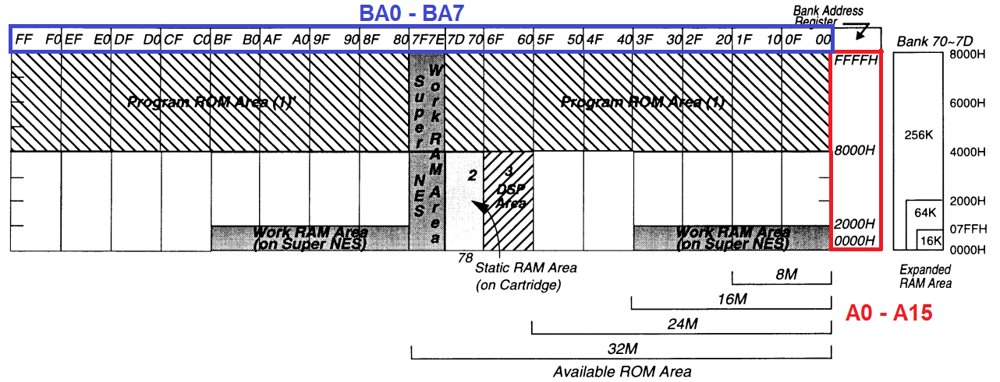
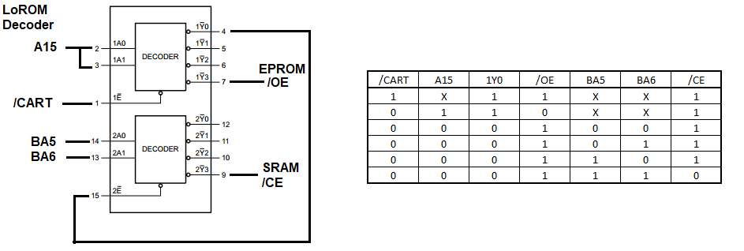
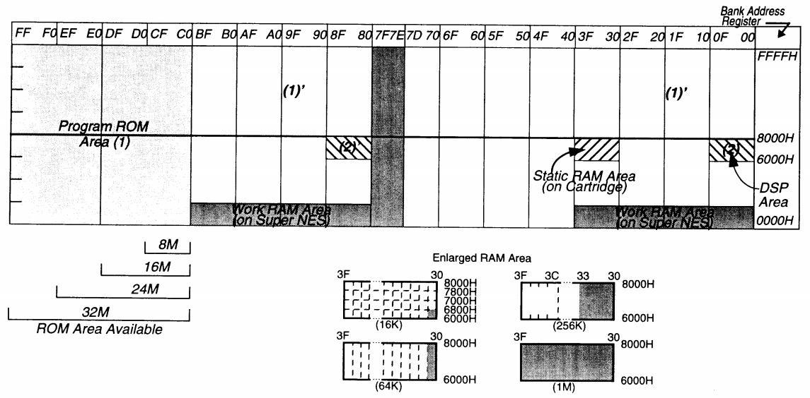
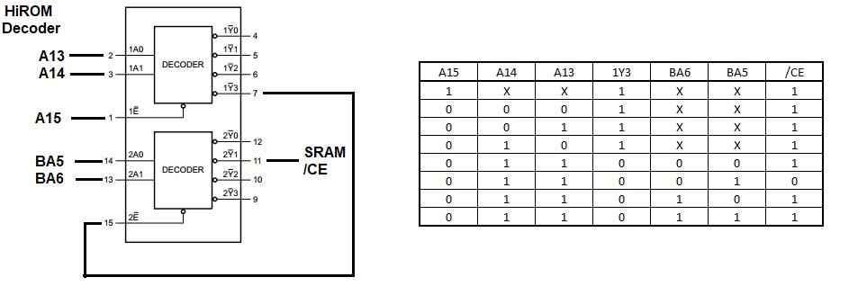

# Guia teórico — Mapeamento LoROM e HiROM no Super Nintendo

**Aplicação:** projeto de cartucho próprio com uma MX29F1610A (2 MiB de ROM) e uma FM18W08 (32 KiB de FeRAM para saves).  
**Escopo:** mapeamentos convencionais LoROM e HiROM, sem SA-1, Super FX, ExLoROM, ExHiROM ou multicart.  
**Versão:** 1.1 — 23/10/2026

> **Objetivo:** entender por que o SNES pode executar jogos a partir de chips de memória semelhantes, mas com circuitos de seleção e endereçamento diferentes. Este documento explica a teoria; **não substitui** a validação de esquemático, pinagem, níveis lógicos e temporização por datasheet.

---

## 1. A ideia mais importante

O processador do SNES coloca um **endereço de 24 bits** no barramento principal (A-bus). O cartucho decide se deve responder a esse acesso e **qual byte físico de sua ROM ou RAM** será selecionado.

**LoROM** e **HiROM** são convenções de mapeamento do cartucho, **não modelos de chips**. Um jogo LoROM não precisa de uma “ROM LoROM”; ele precisa de uma placa que apresente os bytes certos nos endereços certos. A mesma família de Flash pode funcionar em ambas as placas com fiação/decodificação apropriadas.

Em um cartucho simples:

1. O SNES apresenta um endereço (por exemplo, `$01:8000`) e indica leitura ou escrita.
2. O circuito do cartucho reconhece se o endereço corresponde à ROM, à RAM de save ou a nenhuma delas.
3. A lógica coloca o endereço apropriado nos pinos do chip selecionado.
4. Durante uma leitura, **somente** o componente habilitado dirige D0–D7.
5. Durante uma gravação válida de save, somente a FeRAM recebe os controles de escrita corretos.

---

## 2. Entendendo os 24 bits: banco e endereço

O processador 65C816 utiliza endereços de até **24 bits**, correspondendo a um espaço lógico de **16 MiB** (2²⁴ bytes). É organizado como **256 bancos × 64 KiB**.

```text
Endereço completo:  $BB:AAAA
                     │   └── endereço de 16 bits dentro do banco ($0000–$FFFF)
                     └────── banco de 8 bits ($00–$FF)

Exemplos:
$00:8000 = 0x008000
$01:8000 = 0x018000
$C0:1234 = 0xC01234
```

A palavra **banco** é uma organização do espaço de endereços do processador. Não significa necessariamente que há um chip diferente ou uma unidade física de 64 KiB na placa.

### O mapa não é todo ROM

O espaço de 16 MiB inclui, entre outras áreas:

| Faixa lógica | Uso típico |
|---|---|
| `$7E:0000–$7F:FFFF` | 128 KiB de WRAM interna do SNES |
| `$00–$3F` / `$80–$BF`, endereços baixos | Espelhos de WRAM, registradores de I/O e outras áreas do sistema |
| Janelas de ROM | Dados e código do jogo; dependem do mapeamento |
| Janelas de save | RAM do cartucho; dependem do mapeamento |

**Importante:** o tamanho do espaço de endereços do processador (**16 MiB**) não é o tamanho de sua ROM. Uma Flash de **2 MiB** pode aparecer várias vezes, em endereços distintos, graças ao **espelhamento**.

---

## 3. LoROM: janelas de 32 KiB

No **LoROM convencional**, a ROM aparece sobretudo na **metade superior** dos bancos: endereços `$8000–$FFFF` (32 KiB por banco). A faixa `$0000–$7FFF` dos chamados bancos de sistema não é simplesmente mais ROM: contém acessos do próprio SNES.

```text
          BANCO $00             BANCO $01             BANCO $02
        ┌────────────┐        ┌────────────┐        ┌────────────┐
$FFFF   │ ROM 32 KiB │        │ ROM 32 KiB │        │ ROM 32 KiB │
        │ bloco #0   │        │ bloco #1   │        │ bloco #2   │
$8000   ├────────────┤        ├────────────┤        ├────────────┤
        │ Sistema,   │        │ Sistema,   │        │ Sistema,   │
        │ I/O etc.   │        │ I/O etc.   │        │ I/O etc.   │
$0000   └────────────┘        └────────────┘        └────────────┘
```

O **primeiro byte do arquivo da ROM** é visto tipicamente em `$00:8000`, o próximo em `$00:8001`, e assim por diante. Depois de 32 KiB, o próximo bloco começa em `$01:8000`.

### Fórmula LoROM (para uma janela ROM válida)

```text
offset_no_arquivo = ((banco & $7F) << 15) | (endereço & $7FFF)
```

Em que `&` significa AND bit a bit, `<< 15` significa deslocar 15 bits e `|` significa OR bit a bit. **A fórmula calcula o deslocamento somente depois de confirmado que aquele acesso é realmente à ROM**. Não a aplique cegamente às áreas de RAM/I/O.

| Endereço do SNES | Offset do arquivo LoROM | Explicação |
|---|---:|---|
| `$00:8000` | `0x000000` | Primeiro byte |
| `$00:FFFF` | `0x007FFF` | Último byte do primeiro bloco de 32 KiB |
| `$01:8000` | `0x008000` | Segundo bloco |
| `$02:8000` | `0x010000` | Terceiro bloco |
| `$80:8000` | `0x000000` | Espelho do primeiro bloco |

### Quantos blocos cabem na sua MX29F1610A?

A sua Flash tem 2 MiB, isto é, `0x200000` bytes:

```text
2 MiB ÷ 32 KiB = 64 blocos LoROM
```

Portanto, uma organização natural utiliza 64 blocos de 32 KiB. Os demais endereços de ROM compatíveis podem repetir esses blocos, conforme a fiação e a decodificação. **A16–A20 do processador e as linhas físicas do chip não devem ser confundidas com a nomenclatura lógica dos bancos.**

### A15 e seleção da RAM no circuito do artigo





*Imagens: Mouse Bite Labs — [The SNES Cartridge, Briefly Explained](https://mousebitelabs.com/2019/05/18/custom-pcb-explanation/), seção LoROM.*

No circuito ilustrado, **A15 da CPU seleciona regiões**, sem endereçar a ROM: ROM A15 recebe BA0. O primeiro '139 recebe A15 nas duas entradas e `/CART` na habilitação:

- **A15 = 1** (`$8000–$FFFF`): Y3 habilita a saída da ROM.
- **A15 = 0** (`$0000–$7FFF`): Y0 habilita o segundo decodificador.

O segundo estágio seleciona SRAM quando **BA5 = BA6 = 1**. Isso amplia a janela para `$60–$7D`, com espelhos em `$E0–$FF`; `/CART` exclui `$7E–$7F`. É uma simplificação para placas sem DSP, não uma janela universal. Por exemplo, `$73:6000` seleciona RAM, não ROM.

---

## 4. HiROM: janelas de até 64 KiB

No **HiROM convencional**, os bancos `$C0–$FF` e a parte utilizável de `$40–$7D` têm janelas ROM de **64 KiB**, de `$0000–$FFFF`. Além disso, a metade superior dos bancos `$00–$3F` e `$80–$BF` apresenta espelhos de ROM, preservando as regiões do sistema.

```text
          BANCO $C0             BANCO $C1             BANCO $C2
        ┌────────────┐        ┌────────────┐        ┌────────────┐
$FFFF   │            │        │            │        │            │
        │ ROM 64 KiB │        │ ROM 64 KiB │        │ ROM 64 KiB │
        │ bloco #0   │        │ bloco #1   │        │ bloco #2   │
        │            │        │            │        │            │
$0000   └────────────┘        └────────────┘        └────────────┘
```

O primeiro byte da ROM é visto tipicamente em `$C0:0000`; o byte em `0x010000` do arquivo é visto em `$C1:0000`.

### Fórmula HiROM (para uma janela ROM válida)

```text
offset_no_arquivo = ((banco & $3F) << 16) | endereço
```

| Endereço do SNES | Offset do arquivo HiROM | Explicação |
|---|---:|---|
| `$C0:0000` | `0x000000` | Primeiro byte |
| `$C0:8000` | `0x008000` | Segunda metade do primeiro bloco de 64 KiB |
| `$C0:FFFF` | `0x00FFFF` | Último byte do primeiro bloco |
| `$C1:0000` | `0x010000` | Segundo bloco |
| `$00:8000` | `0x008000` | Espelho da ROM dentro de banco de sistema |
| `$01:8000` | `0x018000` | Outro espelho de ROM |

Com 2 MiB:

```text
2 MiB ÷ 64 KiB = 32 blocos HiROM
```

A mesma capacidade física é utilizada. O que muda é **como os endereços do console selecionam os bytes físicos**.

### A15 e seleção da RAM em HiROM





*Imagens: Mouse Bite Labs — [The SNES Cartridge, Briefly Explained](https://mousebitelabs.com/2019/05/18/custom-pcb-explanation/), seção HiROM.*

Em HiROM, **A15 participa do endereço da ROM**. No circuito ilustrado, `/CART` controla sua saída. Para selecionar SRAM, os dois estágios verificam:

- **A15 = 0; A14 = A13 = 1**: janela `$6000–$7FFF`.
- **BA6 = 0; BA5 = 1**: bancos `$20–$3F` e `$A0–$BF`.

A SRAM usa A0–A12 para o byte da página; BA0/BA1 alimentam A13/A14, formando quatro páginas de 8 KiB.

**Aplicação ao seu projeto:** esses diagramas explicam a seleção de memória. A adaptação à FM18W08 continua dependente do controle temporal descrito na seção 8; a correspondência dos pinos da MX29F1610A está discutida na seção 11.

---

## 5. Comparação direta: exatamente o mesmo acesso

Imagine que a CPU solicite o byte em `$01:8000`:

| Item | LoROM | HiROM |
|---|---|---|
| Endereço da CPU | `$01:8000` | `$01:8000` |
| Offset físico lógico da ROM | `0x008000` | `0x018000` |
| Unidade típica por banco | 32 KiB | 64 KiB |
| Principais janelas | Metade superior `$8000–$FFFF` | Bancos inteiros `$C0–$FF`, mais espelhos |
| Save | Geralmente bancos `$70–$7D` / `$F0–$FF` | Geralmente bancos `$20–$3F` / `$A0–$BF` |

**Conclusão elétrica:** se ligar os fios da ROM como em HiROM e inserir uma imagem preparada para LoROM, o processador poderá ler **outros bytes** daqueles que o jogo espera, mesmo que todos os componentes estejam funcionando.

---

## 6. Por que existem espelhos (*mirrors*)?

**Espelhamento** acontece quando endereços diferentes do SNES resultam no **mesmo endereço físico da memória**.

Exemplo simples em LoROM:

```text
$00:8000 ─┐
          ├──> ROM, byte 0x000000
$80:8000 ─┘
```

Isso ocorre porque determinadas linhas de endereço não entram no cálculo do offset físico ou porque uma linha mais alta da Flash não existe/é ignorada em um determinado circuito.

**Espelhamento não duplica o conteúdo armazenado**: os dois endereços acessam os mesmos transistores/células do chip. Tampouco significa que todo endereço de um banco é válido: regiões pertencentes à WRAM e ao I/O têm prioridade no mapa do sistema.

---

## 7. O papel dos sinais A0–A23, /RD, /WR, /ROMSEL e /RAMSEL

A leitura requer mais do que endereçar o chip corretamente.

| Sinal / conceito | Papel básico |
|---|---|
| `A0–A23` | Endereço lógico gerado no A-bus; podem ser utilizados por decodificadores e memória |
| `D0–D7` | Dados, compartilhados entre CPU, ROM e RAM quando pertinentes |
| `/RD` | Indica uma operação de leitura; ativo em nível baixo |
| `/WR` | Indica uma operação de escrita; ativo em nível baixo |
| `/ROMSEL` | Sinal de seleção de ROM fornecido pelo SNES; **não é sinônimo de chip enable de uma ROM em qualquer mapa** |
| `/RAMSEL` | Nome frequentemente usado para uma **saída da lógica do cartucho** que seleciona a RAM; não assumir que é sinal independente existente no conector |
| `/CE`, `/OE`, `/WE` | Entradas dos chips: seleção, habilitação de saída e habilitação de escrita |

Uma barra (`/`) antes do nome significa, por convenção, **ativo em LOW**. Cuidado: `ROMSEL`, `RAM.CE`, `CE1` etc. podem ser escritos sem barra em alguns símbolos, embora representem sinais ativos em nível baixo; confirme o pino no datasheet.

### Dois problemas a evitar

1. **Conflito no barramento:** ROM e FeRAM não podem colocar simultaneamente dados diferentes nas linhas D0–D7. A seleção e `/OE` devem garantir exclusividade.
2. **Gravação acidental:** `/WE` da ROM deve ficar inativo durante o uso; `/WE` da FeRAM deve ser ativado **somente** numa escrita endereçada à janela de save.

O circuito 74HCT139/74HC139 é um exemplo de componente usado para criar saídas de seleção a partir de algumas linhas do barramento. As equações finais dependem de **qual janela LoROM/HiROM** deve responder e de outros sinais disponíveis.

---

## 8. ROM não é RAM de save: onde a FeRAM aparece?

A ROM contém o jogo; a **FeRAM** armazena dados modificados durante o funcionamento (por exemplo, progresso salvo). No seu projeto, a **FM18W08 de 32 KiB** dispensa bateria, mas o console acessa seus dados como se fossem uma RAM de cartucho normal, desde que a lógica respeite os requisitos elétricos e temporais da FeRAM.

### Janela típica de save em LoROM

- Bancos **`$70–$7D` e `$F0–$FF`**, frequentemente na área **`$0000–$7FFF`**.
- Dependendo do tamanho real da RAM e do decodificador, uma parte dessa área é repetida (*mirrored*).
- **A janela RAM precisa ter prioridade sobre a ROM quando aplicável.** Não confundir janelas típicas de save com todas as variantes históricas de placas.

### Janela típica de save em HiROM

- Bancos **`$20–$3F` e `$A0–$BF`**, frequentemente nos endereços **`$6000–$7FFF`**.
- Como cada uma dessas janelas tem 8 KiB, uma FeRAM de 32 KiB ocupa **quatro páginas distintas de 8 KiB**, antes de se repetir.

### Exemplo de 32 KiB em HiROM

Uma implementação convencional pode mapear as quatro páginas assim:

```text
$20:6000–7FFF  -> FeRAM 0x0000–0x1FFF
$21:6000–7FFF  -> FeRAM 0x2000–0x3FFF
$22:6000–7FFF  -> FeRAM 0x4000–0x5FFF
$23:6000–7FFF  -> FeRAM 0x6000–0x7FFF
```

Essa é uma **possível organização**, não uma ligação que se possa copiar cegamente para qualquer PCB. O programa pode contar com espelhos e com uma distribuição específica definida pela placa original.

### FeRAM: cuidado com `/CE` e temporização

**Não trate automaticamente a FM18W08 como uma SRAM assíncrona genérica** apenas porque ambas têm `A0–A14`, `D0–D7`, `/CE`, `/OE` e `/WE`. Consulte os diagramas de ciclo de leitura e escrita do datasheet. A arquitetura FeRAM exige atenção à captura de endereço, habilitação do chip, estabilidade dos dados, sequência dos pulsos e prevenção de escritas espúrias na energização.

A lógica com portas **4081 (AND)** e **4071 (OR)** utilizada pelo projeto *SNES-FeRAM-Cart* é uma referência para estudar esse controle, mas suas expressões e tempos precisam ser conferidos antes de adaptar o circuito à sua MX29F1610A e FM18W08.

---

## 9. Diferença entre mapeamento e velocidade: FastROM / SlowROM

**LoROM/HiROM** descreve *onde* a ROM aparece no espaço de endereços. **FastROM/SlowROM** descreve a modalidade de acesso/temporização usada pelo console em regiões apropriadas.

- Um jogo pode ser **LoROM + SlowROM**, **LoROM + FastROM**, **HiROM + SlowROM** ou **HiROM + FastROM**, desde que hardware e software suportem a combinação.
- O registrador **`$420D` (MEMSEL)** controla a configuração de acesso rápido nas regiões pertinentes.
- **Não confunda FastROM com velocidade nominal de um chip isolado**: o conjunto da placa precisa satisfazer os tempos elétricos esperados.

A escolha de LoROM **não** obriga ROM lenta, nem HiROM significa automaticamente ROM rápida.

---

## 10. O cabeçalho interno da ROM e o arquivo `.sfc`

Uma imagem de ROM típica contém um **cabeçalho interno do jogo**, que faz parte dos dados lidos pelo SNES. Esse cabeçalho não é a mesma coisa que um **header de copiador de 512 bytes** eventualmente adicionado ao começo de arquivos antigos.

### Cabeçalho interno

| Mapeamento | Posição usual do cabeçalho interno no arquivo **sem header de copiador** |
|---|---|
| LoROM | a partir de `0x007FC0` |
| HiROM | a partir de `0x00FFC0` |

Exemplos de campos próximos:

- Offset `+0x15` no cabeçalho: *map mode* (indicador de LoROM/HiROM e velocidade).
- Offset `+0x17`: tamanho declarado da ROM.
- Offset `+0x18`: tamanho declarado da RAM de save.
- Vetores de inicialização e interrupção são acessíveis na parte superior de bancos de sistema.

O cabeçalho ajuda ferramentas e jogos a descreverem o mapeamento, **mas não reprograma eletricamente a PCB**. Alterar só um campo do cabeçalho não converte um jogo de LoROM para HiROM.

### Atenção ao seu TL866 II

Como você grava a Flash antes de soldar:

1. Use uma imagem **sem header de copiador de 512 bytes**, salvo exigência específica de seu fluxo de gravação.
2. Confira capacidade e tamanho: a MX29F1610A armazena **2 MiB / 16 Mbit**.
3. Confirme, no datasheet e no software do gravador, a operação em **modo byte (8 bits)** e a correspondência entre endereços/byte-lane da memória e a sequência do arquivo.
4. Verifique a gravação com a função de leitura/compare do gravador.
5. **Não faça byteswap indiscriminado.** Alguns projetos com EPROM de 16 bits exigem troca dos bytes por causa da fiação escolhida; isso **não implica** que sua placa com MX29F1610A exija o mesmo procedimento. A necessidade deve resultar da pinagem e do modo de programação efetivos.

---

## 11. Ligação lógica da ROM ao processador não é igual à pinagem física

Na MX29F1610A, o modo byte usa uma linha de endereço especial (`DQ15/A-1`), que acrescenta o bit menos significativo do endereço físico. Assim, é essencial distinguir:

- **Endereço de 24 bits da CPU** (`A0–A23`);
- **Offset linear da imagem**, calculado com a fórmula LoROM ou HiROM;
- **Endereço físico de byte da Flash**, que depende de seu modo de operação;
- **Número real de cada pino** do encapsulamento escolhido (SOP-44, conforme seu símbolo).

### Exemplo conceitual: LoROM

```text
CPU solicita $01:8000
     ↓
Decodificador verifica: é uma janela ROM LoROM?
     ↓ SIM
Offset no arquivo = 0x008000
     ↓
Linhas físicas da MX29F1610A selecionam o byte 0x008000
     ↓
/CE e /OE habilitam a leitura → D0–D7 levam o byte ao SNES
```

### Exemplo conceitual: HiROM

```text
CPU solicita $01:8000
     ↓
Decodificador verifica: é uma janela ROM HiROM?
     ↓ SIM
Offset no arquivo = 0x018000
     ↓
Linhas físicas da MX29F1610A selecionam o byte 0x018000
     ↓
/CE e /OE habilitam a leitura → D0–D7 levam o byte ao SNES
```

**Não ligue apenas as linhas homônimas A0→A0, A1→A1, etc. sem construir primeiro essa tabela de endereços.** Em uma Flash de organização 16-bit/8-bit, inclusive, o nome gravado no pino A0 pode não corresponder ao bit menos significativo do endereço físico de byte.

---

## 12. Planejamento de duas placas para seu projeto

### Versão 1: LoROM + FeRAM

**Blocos:**

```text
Conector SNES
 ├── A-bus + D0–D7
 ├── Decodificador LoROM ──> /CE, /OE da MX29F1610A
 ├── Decodificador RAM ────> Controle /CE, /OE, /WE da FM18W08
 └── SuperCIC (se necessário)
```

**Metas de teste (em sequência):**

1. Ler corretamente a ROM (jogo de teste sem save).
2. Conferir reset e vetores de inicialização.
3. Verificar o sinal de seleção da RAM apenas na região de save.
4. Testar leitura e escrita da FeRAM.
5. Desligar o console e confirmar persistência dos dados.

### Versão 2: HiROM + FeRAM

Reaproveita os componentes, o barramento de dados e os conceitos do controle FeRAM, mas **altera a transformação de endereço e a decodificação de ROM/RAM**. Não é seguro assumir que somente um jumper em `/CE` resolve a mudança.

---

## 13. Erros clássicos de projeto

- **Confundir bancos do SNES com bancos de memória física:** bancos de 64 KiB são uma convenção lógica; a ROM pode mapear apenas 32 KiB de cada um.
- **Conectar a ROM diretamente sem validar a tradução de endereço:** o jogo lê dados errados.
- **Decodificar só com `/RD` ou só com `/ROMSEL` sem verificar os intervalos:** ROM pode responder a acessos indevidos.
- **Ignorar espelhamentos da RAM:** jogos podem depender de um certo arranjo ou repetir páginas de save.
- **Deixar `/WE` da FeRAM vulnerável a pulsos espúrios:** pode corromper saves.
- **Ativar ROM e FeRAM ao mesmo tempo:** risco de contenção em D0–D7.
- **Confundir header interno com header extra de 512 bytes:** desloca toda a ROM gravada.
- **Aplicar byteswap de outro projeto:** pode inverter o conteúdo incorretamente.
- **Achar que HiROM = FastROM:** são características diferentes.
- **Esperar que um chip de 2 MiB execute nativamente qualquer jogo de 4 MiB ou 8 MiB:** capacidade e mapeamento são restrições independentes.

---

## 14. Exercícios rápidos (com respostas)

**A.** Em LoROM, qual offset da ROM é lido em `$03:9000`?

```text
((0x03 & 0x7F) << 15) | (0x9000 & 0x7FFF)
= 0x018000 | 0x1000
= 0x019000
```

**B.** Em HiROM, qual offset da ROM é lido em `$C3:9000`?

```text
((0xC3 & 0x3F) << 16) | 0x9000
= 0x030000 | 0x9000
= 0x039000
```

**C.** Uma ROM de 2 MiB contém quantos blocos de 32 KiB e 64 KiB?

```text
2 MiB / 32 KiB = 64 blocos
2 MiB / 64 KiB = 32 blocos
```

**D.** Se o jogo salva em `$20:6000`, a região é típica de qual mapeamento?

**Resposta:** HiROM convencional, na janela de SRAM/FeRAM do cartucho.

---

## 15. Referências para aprofundamento

1. [Super Famicom Development Wiki — Memory Mapping](https://wiki.superfamicom.org/memory-mapping): mapa do sistema e distinção entre barramento do SNES e resposta dos cartuchos.
2. [snesdev — memmap.txt](https://github.com/gilligan/snesdev/blob/master/docs/memmap.txt): descrição detalhada das regiões da CPU.
3. [SMW Editor — Address Conversion](https://smw-editor.github.io/docs/smw-rom/address-conversion/): fórmulas de tradução de endereços LoROM, HiROM e variantes.
4. [PVSnesLib — SNES ROM Header](https://github.com/alekmaul/pvsneslib/wiki/SNES-ROM-Header): posição e campos do cabeçalho interno.
5. [MouseBiteLabs — Super Nintendo Cartridges](https://github.com/MouseBiteLabs/Super-Nintendo-Cartridges): designs LoROM/HiROM com Flash e lógica de seleção.
6. [soniccd123 — SNES-FeRAM-Cart](https://github.com/soniccd123/SNES-FeRAM-Cart): exemplo de controle de FeRAM e jumpers de mapeamento.

7. [Mouse Bite Labs — The SNES Cartridge, Briefly Explained](https://mousebitelabs.com/2019/05/18/custom-pcb-explanation/): fonte dos quatro diagramas locais e da explicação dos decodificadores nas seções 3 e 4. As imagens são do autor do artigo.

### Próximo passo prático

Antes de completar `snes_lo_hi_rom.kicad_sch`, construir e validar três tabelas separadas para **cada placa**: **(1)** endereços CPU → ROM, **(2)** endereços CPU → FeRAM e **(3)** equações de `/CE`, `/OE`, `/WE`. Em seguida confrontá-las com a pinagem física da MX29F1610A/FM18W08 e os diagramas de tempo dos datasheets.
